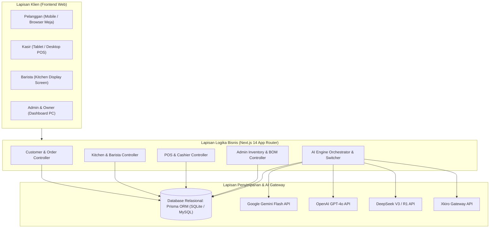
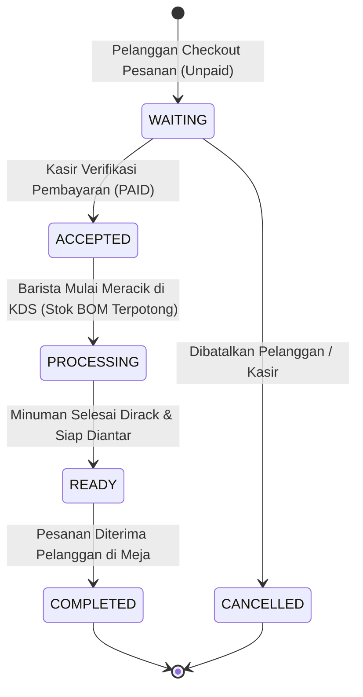
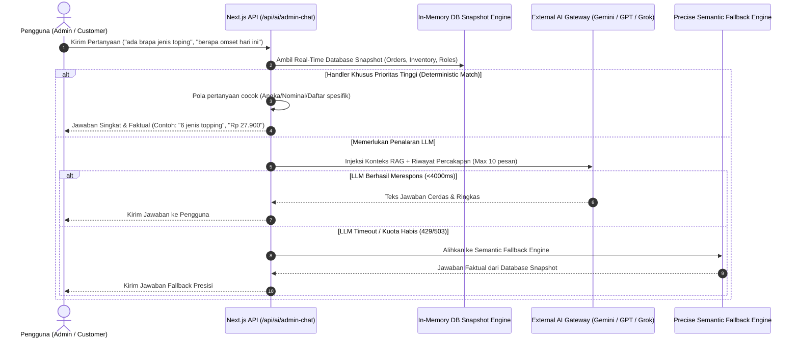

# DOKUMEN SPESIFIKASI KEBUTUHAN PERANGKAT LUNAK (SRS / PRD) — TAHAP 1
## Sistem Informasi Pemesanan, Kasir (POS), Inventaris & Barista AI Cerdas "Kopi Mahasiswa"

> **Standar Dokumentasi**: IEEE Std 830-1998 / ISO/IEC/IEEE 29148:2018  
> **Mata Kuliah**: Rekayasa Perangkat Lunak (RPL)  
> **Versi Dokumen**: 1.0.0 (Tahap 1 — Analisis Kebutuhan & Perancangan Arsitektur)  
> **Status Dokumen**: Disetujui (Approved)  

---

### Identitas Pengembang / Penyusun

| Atribut | Keterangan |
| :--- | :--- |
| **Nama Lengkap** | **M. Revandya Wibowo** |
| **Nomor Induk Mahasiswa (NIM)** | **41257114** |
| **Program Studi / Kelas** | S1 Teknik Informatika / **TI - 1B - 2025** |
| **Tema / Topik Kelompok** | **Kopi Mahasiswa** (Smart Coffee Shop System) |
| **Tahun Akademik** | 2025 / 2026 |

---

## DAFTAR ISI

1. [BAB I: PENDAHULUAN](#bab-i-pendahuluan)
   - 1.1 [Tujuan Dokumen](#11-tujuan-dokumen)
   - 1.2 [Latar Belakang Masalah](#12-latar-belakang-masalah)
   - 1.3 [Ruang Lingkup Produk (Product Scope)](#13-ruang-lingkup-produk-product-scope)
   - 1.4 [Definisi, Istilah, dan Akronim](#14-definisi-istilah-dan-akronim)
   - 1.5 [Referensi Dokumen](#15-referensi-dokumen)
2. [BAB II: GAMBARAN UMUM PRODUK & ARSITEKTUR TEKNIS](#bab-ii-gambaran-umum-produk--arsitektur-teknis)
   - 2.1 [Perspektif Produk](#21-perspektif-produk)
   - 2.2 [Karakteristik Pengguna (Role-Based Access Control / RBAC)](#22-karakteristik-pengguna-role-based-access-control--rbac)
   - 2.3 [Lingkungan Operasional & Stack Teknologi](#23-lingkungan-operasional--stack-teknologi)
   - 2.4 [Desain Antarmuka & Tema Visual](#24-desain-antarmuka--tema-visual)
   - 2.5 [Batasan Desain & Implementasi](#25-batasan-desain--implementasi)
   - 2.6 [Asumsi dan Dependensi](#26-asumsi-dan-dependensi)
3. [BAB III: SPESIFIKASI KEBUTUHAN FUNGSIONAL](#bab-iii-spesifikasi-kebutuhan-fungsional)
   - 3.1 [Daftar Kebutuhan Fungsional (Functional Requirements)](#31-daftar-kebutuhan-fungsional-functional-requirements)
   - 3.2 [User Stories & Acceptance Criteria — Modul Pelanggan (Customer)](#32-user-stories--acceptance-criteria--modul-pelanggan-customer)
   - 3.3 [User Stories & Acceptance Criteria — Modul Admin & Kasir](#33-user-stories--acceptance-criteria--modul-admin--kasir)
   - 3.4 [Alur Pemesanan & Kitchen Display System (Barista)](#34-alur-pemesanan--kitchen-display-system-barista)
4. [BAB IV: SPESIFIKASI FITUR KECERDASAN BUATAN (AI ENGINE)](#bab-iv-spesifikasi-fitur-kecerdasan-buatan-ai-engine)
   - 4.1 [Arsitektur Integrasi AI Real-Time](#41-arsitektur-integrasi-ai-real-time)
   - 4.2 [Barista AI Chatbot (Customer Facing)](#42-barista-ai-chatbot-customer-facing)
   - 4.3 [Admin AI Assistant (Management Facing)](#43-admin-ai-assistant-management-facing)
   - 4.4 [AI Engine Switcher & Multi-Model Gateway](#44-ai-engine-switcher--multi-model-gateway)
   - 4.5 [Mekanisme Fault-Tolerance & Fallback](#45-mekanisme-fault-tolerance--fallback)
5. [BAB V: KEBUTUHAN NON-FUNGSIONAL (NFR)](#bab-v-kebutuhan-non-fungsional-nfr)
   - 5.1 [Kinerja & Performa (Performance)](#51-kinerja--performa-performance)
   - 5.2 [Keamanan & Integritas Data (Security)](#52-keamanan--integritas-data-security)
   - 5.3 [Kemudahan Penggunaan & Aksesibilitas (Usability & Ergonomics)](#53-kemudahan-penggunaan--aksesibilitas-usability--ergonomics)
   - 5.4 [Keandalan & Ketersediaan (Reliability & Availability)](#54-keandalan--ketersediaan-reliability--availability)
   - 5.5 [Pemeliharaan & Ekstensibilitas (Maintainability)](#55-pemeliharaan--ekstensibilitas-maintainability)
6. [BAB VI: MATRIKS KETERTELUSURAN (TRACEABILITY MATRIX)](#bab-vi-matriks-ketertelusuran-traceability-matrix)
7. [BAB VII: PENUTUP & PENGESAHAN](#bab-vii-penutup--pengesahan)

---

## BAB I: PENDAHULUAN

### 1.1 Tujuan Dokumen
Dokumen Spesifikasi Kebutuhan Perangkat Lunak (*Software Requirements Specification* - SRS) ini disusun sebagai dokumen acuan resmi perancangan (*Product Requirements Document* - PRD Tahap 1) dalam mata kuliah Rekayasa Perangkat Lunak. Dokumen ini bertujuan untuk:
1. Mendefinisikan secara menyeluruh kebutuhan fungsional dan non-fungsional aplikasi web **Kopi Mahasiswa**.
2. Menjadi kontrak kerja sama teknis antara pemangku kepentingan (*stakeholders*): pelanggan mahasiswa, barista, kasir, administrator, dan pemilik kafe.
3. Memberikan panduan implementasi arsitektur perangkat lunak, struktur basis data, serta integrasi modul kecerdasan buatan (*Artificial Intelligence*).

### 1.2 Latar Belakang Masalah
Kultur kedai kopi (*coffee shop*) di lingkungan kampus telah bertransformasi menjadi ruang kerja bersama (*co-working space*) kedua bagi mahasiswa untuk mengerjakan tugas kelompok, skripsi, maupun berdiskusi. Namun, operasional kedai kopi di sekitar kampus kerap menghadapi permasalahan berikut:
1. **Antrean Pemesanan yang Padat pada Jam Sibuk (*Peak Hours*)**:  
   Pencatatan manual di meja kasir menyebabkan antrean mengular panjang pada jam istirahat kuliah dan menjelang malam. Mahasiswa sering kali harus menunggu lama hanya untuk memilih menu.
2. **Ketiadaan Informasi Ketersediaan Meja Secara Terbuka**:  
   Pelanggan sering memesan minuman terlebih dahulu, namun mendapati seluruh meja telah terisi penuh oleh mahasiswa yang sedang belajar, sehingga memicu pembatalan order atau ketidaknyamanan.
3. **Keterbatasan Rekomendasi Menu yang Personal**:  
   Menu kafe memiliki ragam varian (*espresso-based*, *milk coffee*, non-kopi, tingkat kemanisan, *ice/hot*, hingga *topping*). Pelanggan baru sering kali bingung menentukan menu yang pas dengan preferensi rasa atau anggaran kantong mahasiswa tanpa adanya bantuan interaktif.
4. **Disinkronisasi Inventaris dan Pemotongan Stok Bahan Baku**:  
   Kasir manual tidak terintegrasi secara *real-time* dengan bahan baku dapur (biji kopi, susu segar, sirup perisa, cup, sedotan). Hal ini mengakibatkan insiden *out-of-stock* saat pesanan sudah dibayar oleh pelanggan.
5. **Keterlambatan Analitik Bisnis bagi Pemilik Kafe**:  
   Pemilik usaha (*owner*) tidak dapat memantau perputaran omset harian, tren menu terlaris (*best seller*), dan sisa stok kritis secara instan dari jarak jauh.

Berdasarkan permasalahan di atas, dikembangkan solusi perangkat lunak **"Kopi Mahasiswa"**: sistem manajemen kafe cerdas berbasis web yang mengintegrasikan pemesanan mandiri per meja, POS kasir, *Kitchen Display System* (KDS) barista, manajemen inventaris terotomatisasi (*Bill of Materials*), serta **Barista AI Chatbot** cerdas untuk melayani pelanggan secara *real-time*.

### 1.3 Ruang Lingkup Produk (Product Scope)
Aplikasi **Kopi Mahasiswa** mencakup modul-modul berikut:
- **Modul Pelanggan (Customer Web App)**: Akses katalog menu digital, pemilihan meja kafe, kustomisasi varian dan *topping*, keranjang belanja, checkout QRIS/Tunai, klaim kupon promo mahasiswa, dan interaksi dengan *Barista AI*.
- **Modul Dapur Barista (Kitchen Display System / KDS)**: Pemantauan tiket pesanan racikan masuk secara *real-time*, pembaruan status racikan (`WAITING` $\rightarrow$ `PROCESSING` $\rightarrow$ `READY`), dan pemicu pemotongan stok bahan baku.
- **Modul Kasir (Point of Sale / POS)**: Validasi pesanan meja maupun *walk-in*, verifikasi status pembayaran (*PAID*), pencetakan struk transaksi, dan pembatalan pesanan.
- **Modul Administrator & Owner (Admin Dashboard)**: Manajemen master menu & harga, master bahan baku & resep racikan (BOM), audit log mutasi stok, persetujuan kartu tanda mahasiswa (KTM) untuk keanggotaan diskon, metrik analitik omset, serta panel **AI Engine Switcher**.

### 1.4 Definisi, Istilah, dan Akronim
| Istilah / Akronim | Penjelasan |
| :--- | :--- |
| **SRS** | *Software Requirements Specification* (Dokumen Spesifikasi Kebutuhan Perangkat Lunak). |
| **PRD** | *Product Requirements Document* (Dokumen Panduan Kebutuhan Produk). |
| **RBAC** | *Role-Based Access Control* (Pembatasan hak akses sistem berdasarkan peran pengguna). |
| **BOM** | *Bill of Materials* (Resep takaran baku bahan per produk, misal 18g biji kopi + 120ml susu). |
| **KDS** | *Kitchen Display System* (Tampilan layar antrean pesanan di meja barista/dapur). |
| **POS** | *Point of Sale* (Sistem kasir pencatatan transaksi penjualan). |
| **AOV** | *Average Order Value* (Rata-rata nilai nominal transaksi pesanan). |
| **RAG** | *Retrieval-Augmented Generation* (Teknik injeksi konteks data database ke model AI). |
| **LLM** | *Large Language Model* (Model bahasa kecerdasan buatan, seperti Gemini, GPT, DeepSeek). |

### 1.5 Referensi Dokumen
1. IEEE Std 830-1998: *IEEE Recommended Practice for Software Requirements Specifications*.
2. ISO/IEC/IEEE 29148:2018: *Systems and software engineering — Life cycle processes — Requirements engineering*.
3. Next.js Documentation (v14.x App Router Architecture), Vercel Inc.
4. Prisma ORM Documentation (Relational Database Mapping), Prisma Data Inc.

---

## BAB II: GAMBARAN UMUM PRODUK & ARSITEKTUR TEKNIS

### 2.1 Perspektif Produk
Kopi Mahasiswa adalah sistem web mandiri (*self-contained full-stack web application*) yang dapat dioperasikan secara lokal (*on-premise* menggunakan jaringan intranet kafe) maupun diunggah ke server *cloud*. Sistem berinteraksi dengan API eksternal kecerdasan buatan (Google GenAI, OpenAI, DeepSeek, Xkiro) serta *payment gateway* / sistem validasi pembayaran.

### 2.2 Karakteristik Pengguna (Role-Based Access Control / RBAC)
Sistem menerapkan proteksi peran berjenjang (*5 User Roles*) yang dikontrol melalui enkripsi *token* JWT:

| Peran (Role) | Hak Akses Utama | Tujuan Penggunaan |
| :--- | :--- | :--- |
| **Customer (Pelanggan)** | Membaca katalog menu, memesan meja, kustomisasi topping, checkout, chat dengan Barista AI, melihat status order sendiri. | Mahasiswa/pengunjung yang menikmati kopi dan suasana kafe. |
| **Cashier (Kasir)** | Menerima pesanan walk-in/meja, validasi pembayaran (Cash/QRIS), mencetak struk, membatalkan pesanan keliru. | Staf kasir operasional depan kafe. |
| **Barista** | Melihat antrean pesanan KDS, mengubah status pengerjaan racikan, memantau ketersediaan stok racikan. | Staf dapur / peracik minuman kopi. |
| **Admin** | Hak akses penuh: konfigurasi sistem, edit menu & harga, master bahan baku, resep BOM, verifikasi KTM, switcher AI model. | Manajer operasional harian kafe. |
| **Owner (Pemilik)** | Akses baca (*read-only*) seluruh laporan keuangan, omset, ranking produk, audit log aktivitas karyawan. | Pemilik modal / pemilik usaha kedai kopi. |

### 2.3 Lingkungan Operasional & Stack Teknologi
- **Server Framework**: [Next.js 14](https://nextjs.org/) (React 18, App Router, Server Actions, Route Handlers).
- **Bahasa Pemrograman**: [TypeScript](https://www.typescriptlang.org/) dengan *Strict Type-Checking*.
- **Styling UI**: [Tailwind CSS 3.x](https://tailwindcss.com/) dengan modul `@tailwindcss/typography`.
- **Database Abstraction**: [Prisma ORM](https://www.prisma.io/) v5.x.
- **Database Engine**: [SQLite](https://www.sqlite.org/) (Lingkungan *Development*) / [MySQL](https://www.mysql.com/) (Lingkungan *Production*).
- **State Management**: [Zustand](https://zustand-demo.pmnd.rs/) untuk sinkronisasi *cart* dan status UI.
- **AI Integration**:
  - `@google/genai` (SDK Native Google Gemini).
  - REST API Fetch Client untuk OpenAI, DeepSeek, dan Xkiro Gateway.

### 2.4 Desain Antarmuka & Tema Visual
1. **Identitas Warna (Warm Espresso & Cream)**:  
   Menggunakan kombinasi warna hangat yang mencerminkan biji kopi dan krim susu:
   - Warna Utama: *Deep Roasted Coffee* (`#1E1611`), *Warm Amber* (`#D97706`), dan *Cream Latte* (`#FDF8F3`).
   - Warna Status: Hijau Zamrud (Tersedia / Lunas), Oranye Karamel (Dalam Proses), Merah Bata (Stok Kritis / Batal).
2. **Dukungan Dark Mode & Light Mode**:  
   Sistem menyimpan preferensi tema pengguna pada *local storage*, memastikan kenyamanan visual pelanggan baik di kondisi kafe temaram (*night ambient*) maupun di luar ruangan (*outdoor daylight*).

### 2.5 Batasan Desain & Implementasi
- Sistem berjalan pada browser modern yang mendukung standar ECMAScript 2022+ (Google Chrome, Mozilla Firefox, Safari, Microsoft Edge).
- Database default menggunakan SQLite yang disimpan secara lokal (`prisma/dev.db`), sehingga tidak memerlukan konfigurasi server database terpisah pada tahap demonstrasi.
- Komunikasi AI eksternal membutuhkan akses internet aktif; namun jika koneksi terputus, sistem secara otomatis mengaktifkan *Deterministic Simulation Engine* bawaan.

### 2.6 Asumsi dan Dependensi
- Pelanggan diasumsikan memiliki perangkat pintar (*smartphone*) dengan koneksi internet untuk memindai QR Meja atau membuka tautan pemesanan.
- Kasir dan Barista menggunakan layar tablet atau PC di area bar kafe yang terhubung ke jaringan lokal yang sama.

---

## BAB III: SPESIFIKASI KEBUTUHAN FUNGSIONAL

### 3.1 Daftar Kebutuhan Fungsional (Functional Requirements)

| Kode Kebutuhan | Deskripsi Modul / Fitur | Kategori Peran |
| :--- | :--- | :--- |
| **REQ-F01** | Pengguna dapat melakukan registrasi, login, dan logout dengan proteksi JWT. | Semua Pengguna |
| **REQ-F02** | Pengguna dapat beralih tema visual antara *Dark Mode* dan *Light Mode*. | Semua Pengguna |
| **REQ-F03** | Pelanggan dapat menjelajahi katalog menu berdasarkan kategori (Kopi, Non-Kopi, Snack, Promo). | Pelanggan |
| **REQ-F04** | Pelanggan dapat mengonfigurasi varian minuman (*Hot/Iced, Regular/Large*) dan memilih *topping*. | Pelanggan |
| **REQ-F05** | Pelanggan dapat memilih nomor meja kafe yang berstatus kosong (*AVAILABLE*). | Pelanggan |
| **REQ-F06** | Pelanggan dapat menerapkan kode kupon/voucher diskon pada saat checkout. | Pelanggan |
| **REQ-F07** | Pelanggan dapat memantau status pengerjaan pesanan secara *real-time*. | Pelanggan |
| **REQ-F08** | Pelanggan dapat berinteraksi dengan Barista AI Chatbot untuk meminta rekomendasi menu. | Pelanggan |
| **REQ-F09** | Kasir dapat melihat daftar pesanan masuk dan memverifikasi pembayaran (Tunai / QRIS). | Kasir |
| **REQ-F10** | Kasir dapat mencetak struk transaksi penjualan resmi. | Kasir |
| **REQ-F11** | Barista dapat melihat tiket pesanan pada antarmuka KDS dan memperbarui status pengerjaan. | Barista |
| **REQ-F12** | Sistem otomatis memotong stok bahan baku saat pesanan diproses sesuai resep (BOM). | Sistem / Barista |
| **REQ-F13** | Admin dapat menambah, mengubah, dan menonaktifkan produk, kategori, serta *topping*. | Admin |
| **REQ-F14** | Admin dapat mengelola master bahan baku, satuan unit, supplier, dan memantau stok kritis. | Admin |
| **REQ-F15** | Admin dapat mengatur formula takaran resep (BOM) per produk. | Admin |
| **REQ-F16** | Admin dapat mencatat transaksi mutasi stok (*IN, OUT, ADJUSTMENT*). | Admin |
| **REQ-F17** | Admin & Owner dapat melihat grafik analitik omset harian, mingguan, bulanan, dan ranking menu. | Admin, Owner |
| **REQ-F18** | Admin dapat memilih engine model AI aktif (Gemini, GPT, DeepSeek, Xkiro) dan menguji API Key. | Admin |
| **REQ-F19** | Admin dapat bertanya kepada Admin AI Assistant terkait data toko secara presisi (*to the point*). | Admin, Owner |

---

### 3.2 User Stories & Acceptance Criteria — Modul Pelanggan (Customer)

#### User Story 1: Pemesanan Menu & Kustomisasi Varian
- **Sebagai**: Pelanggan kafe mahasiswa  
- **Saya ingin**: Memilih menu kopi, menentukan suhu (*Hot/Iced*), ukuran, dan menambah topping favorit  
- **Agar**: Pesanan minuman sesuai dengan selera rasa pribadi saya  

| ID Kriteria | Kondisi (Given) | Tindakan (When) | Hasil yang Diharapkan (Then) |
| :--- | :--- | :--- | :--- |
| **AC-1.1** | Pelanggan berada di halaman katalog `/menu` | Pelanggan menekan salah satu kartu produk (misal: "Classic Caffe Latte") | Sistem menampilkan modal kustomisasi dengan rincian harga dasar dan opsi varian. |
| **AC-1.2** | Modal kustomisasi produk terbuka | Pelanggan memilih varian "Iced Large (+Rp 2.000)" dan topping "Extra Shot (+Rp 5.000)" | Total subtotal kalkulasi pada tombol "Tambah ke Pesanan" otomatis terbarui dari Rp 19.000 menjadi Rp 26.000. |
| **AC-1.3** | Produk telah dikonfigurasi | Pelanggan menekan tombol "Tambah ke Pesanan" | Produk masuk ke dalam *Cart Drawer* (Zustand store) dan *badge counter* keranjang bertambah 1. |

---

#### User Story 2: Pemilihan Meja Interaktif
- **Sebagai**: Pelanggan yang datang ke kedai kopi  
- **Saya ingin**: Memilih nomor meja kafe yang masih kosong secara interaktif  
- **Agar**: Barista dan kasir dapat mengantarkan pesanan langsung ke meja tempat saya duduk  

| ID Kriteria | Kondisi (Given) | Tindakan (When) | Hasil yang Diharapkan (Then) |
| :--- | :--- | :--- | :--- |
| **AC-2.1** | Pelanggan berada di halaman checkout | Pelanggan membuka panel pemilihan meja | Sistem menampilkan daftar meja dengan indikator warna: Hijau (*Available*) dan Abu-abu (*Occupied*). |
| **AC-2.2** | Meja nomor 04 berstatus *Available* | Pelanggan menekan Meja nomor 04 | Nomor Meja 04 terpilih dan tersimpan di data transaksi pesanan. |
| **AC-2.3** | Meja nomor 07 berstatus *Occupied* | Pelanggan menekan Meja nomor 07 | Sistem mencegah pemilihan dan menampilkan pesan peringatan bahwa meja sedang digunakan. |

---

#### User Story 3: Interaksi dengan Barista AI Chatbot
- **Sebagai**: Pelanggan yang bingung memilih menu kopi  
- **Saya ingin**: Bertanya kepada Barista AI tentang menu kopi yang manis, creamy, dan ramah kantong  
- **Agar**: Saya mendapatkan rekomendasi menu terbaik tanpa perlu bertanya panjang kepada kasir  

| ID Kriteria | Kondisi (Given) | Tindakan (When) | Hasil yang Diharapkan (Then) |
| :--- | :--- | :--- | :--- |
| **AC-3.1** | Widget Barista AI terbuka di sisi kanan bawah | Pelanggan mengirimkan pesan: *"Kopi apa yang manis dan harganya di bawah 20 ribu?"* | Barista AI menganalisis katalog database dan merekomendasikan "Kopi Susu Mahasiswa (KSM)" seharga Rp 15.000. |
| **AC-3.2** | Pelanggan ingin tahu tempat duduk kosong | Pelanggan mengirimkan pesan: *"Apakah ada meja kosong?"* | Barista AI membaca snapshot meja database dan menjawab jumlah meja kosong saat ini secara akurat. |

---

### 3.3 User Stories & Acceptance Criteria — Modul Admin & Kasir

#### User Story 4: Pemotongan Stok Bahan Baku Otomatis (BOM)
- **Sebagai**: Administrator Kafe  
- **Saya ingin**: Setiap pesanan yang diproses barista otomatis memotong stok bahan baku berdasarkan resep  
- **Agar**: Data sisa bahan baku di gudang selalu akurat tanpa perlu penghitungan manual berkala  

| ID Kriteria | Kondisi (Given) | Tindakan (When) | Hasil yang Diharapkan (Then) |
| :--- | :--- | :--- | :--- |
| **AC-4.1** | Menu "Americano" memiliki resep BOM: 20 gram Biji Kopi Espresso + 1 Cup 16oz | Barista mengubah status pesanan Americano menjadi `PROCESSING` | Sistem otomatis membuat mutasi stok tipe `OUT` dan mengurangi 20g biji kopi serta 1 pcs cup pada cabang terkait. |
| **AC-4.2** | Sisa stok Biji Kopi turun di bawah batas minimum (misal: sisa 400g dari batas min 500g) | Mutasi stok selesai dijalankan | Sistem menandai bahan baku berstatus **LOW STOCK** dan memunculkan notifikasi peringatan di dashboard admin. |

---

#### User Story 5: Pergantian Engine AI Secara Dinamis (AI Engine Switcher)
- **Sebagai**: Administrator Sistem  
- **Saya ingin**: Mengganti model AI aktif antara Google Gemini, OpenAI GPT, DeepSeek, dan Xkiro Gateway melalui UI  
- **Agar**: Kafe dapat menyesuaikan efisiensi biaya komputasi, kuota token, dan keandalan respons AI  

| ID Kriteria | Kondisi (Given) | Tindakan (When) | Hasil yang Diharapkan (Then) |
| :--- | :--- | :--- | :--- |
| **AC-5.1** | Admin berada di menu `/admin/settings/ai` | Admin memilih kartu "Google Gemini" lalu menekan tombol "Aktifkan" | Sistem menyimpan pengaturan di database (`active_ai_model = 'gemini'`) dan seluruh chat bot langsung dialihkan ke engine Gemini. |
| **AC-5.2** | Admin memasukkan API Key baru untuk model xAI Grok / OpenAI | Admin menekan tombol "Uji Koneksi" | Sistem mengirim request uji coba; jika valid, menampilkan status hijau "Tersambung (Latency: xx ms)". Jika gagal, menampilkan pesan error spesifik tanpa merusak sistem. |

---

### 3.4 Alur Pemesanan & Kitchen Display System (Barista)

Siklus hidup status pesanan (*Order Lifecycle*) didefinisikan sebagai mesin status (*State Machine*) berikut:

---

## BAB IV: SPESIFIKASI FITUR KECERDASAN BUATAN (AI ENGINE)

### 4.1 Arsitektur Integrasi AI Real-Time
Sistem menerapkan pola **Context-Aware Hybrid AI Architecture** yang memadukan keamanan data operasional kafe dengan kecerdasan pemrosesan bahasa alami dari LLM:

### 4.2 Barista AI Chatbot (Customer Facing)
- **Lokasi Antarmuka**: Widget mengambang (*floating chat pill*) di pojok kanan bawah seluruh halaman katalog pelanggan.
- **Karakter Asisten**: Ramah, santun, khas barista profesional muda (*Warm Barista Persona*).
- **Kemampuan Utama**:
  1. *Menu Recommendation*: Menyarankan menu berdasarkan rasa (asam segar, manis cokelat, kopi kuat, atau bebas kafein).
  2. *Live Table Availability*: Memeriksa sisa meja kosong secara langsung agar pelanggan tidak kehabisan tempat.
  3. *Budget Matching*: Memberikan saran paket hemat untuk mahasiswa (misal: menu di bawah Rp 20.000).

### 4.3 Admin AI Assistant (Management Facing)
- **Lokasi Antarmuka**: Modal asisten cerdas pada Dashboard Admin (`/admin`).
- **Aturan Jawaban (Ultra-Concise & Direct Guidelines)**:
  1. **Pertanyaan Angka / Jumlah**: Bot HANYA mengembalikan nominal/angka (contoh: *"ada brapa jumlah role"* $\rightarrow$ **`5 role`**; *"ada brapa jenis non kopi"* $\rightarrow$ **`2 menu non-kopi`**).
  2. **Pertanyaan Nama**: Bot HANYA mengembalikan nama yang ditanyakan (contoh: *"siapa barista"* $\rightarrow$ **`Barista Budi`**).
  3. **Pertanyaan Kontekstual Lanjutan (*Follow-up*)**: Mampu membaca riwayat pesan sebelumnya. Jika sebelumnya menampilkan omset harian `Rp 27.900` lalu ditanya *"itu pembelian apa?"*, bot otomatis membaca pesanan lunas hari ini dan merinci: `1x Classic Caffe Latte (Rp 27.900 - Meja 03)`.

### 4.4 AI Engine Switcher & Multi-Model Gateway
Sistem mendukung integrasi multi-provider yang dapat diganti sewaktu-waktu oleh Admin:
1. **Google Gemini Flash (Default & Rekomendasi Utama)**:
   - Terintegrasi native via `@google/genai` SDK (`gemini-2.0-flash` / `gemini-1.5-flash`).
   - Latensi instan (<400ms) dan hemat konsumsi kuota.
2. **OpenAI GPT**:
   - Model `gpt-4o-mini` / `gpt-4o` dengan penalaran terstruktur.
3. **DeepSeek AI**:
   - Model open-weights efisien tinggi untuk penalaran logika bisnis.
4. **Xkiro AI Gateway**:
   - Gateway multi-model Nous Research berbasis `mistralai/mistral-small-24b3` dan Cohere Command A+.

### 4.5 Mekanisme Fault-Tolerance & Fallback
Untuk menjamin aplikasi kafe tidak pernah *crash* akibat gangguan penyedia AI pihak ketiga, sistem dilengkapi 3 lapisan pertahanan:
- **Lapisan 1 (Deterministic Handlers)**: Pertanyaan faktual (omset, harga produk, jumlah user, meja) langsung dijawab oleh algoritma internal tanpa memanggil API pihak ketiga.
- **Lapisan 2 (Timeout Guard 4s)**: Panggilan API ke penyedia AI dibatasi maksimal 4.000 ms dengan `Promise.race` untuk mencegah *hanging* pada koneksi lambat.
- **Lapisan 3 (Semantic Simulation Engine)**: Jika terjadi galat kuota (HTTP 429) atau server down (HTTP 503), kueri dialihkan secara otomatis ke *Semantic Question-Answering Engine* lokal yang membaca snapshot data SQLite.

---

## BAB V: KEBUTUHAN NON-FUNGSIONAL (NFR)

### 5.1 Kinerja & Performa (Performance)
- **NFR-P01**: Halaman web pelanggan harus dimuat dalam waktu kurang dari 2 detik pada koneksi internet seluler standar (4G / 15 Mbps).
- **NFR-P02**: Pemrosesan transaksi checkout dan mutasi stok di database tidak boleh memakan waktu lebih dari 500 ms.
- **NFR-P03**: Waktu respons Chatbot AI lokal / deterministic handler harus di bawah 100 ms.
- **NFR-P04**: Skalabilitas aplikasi mampu menangani minimal 50 transaksi pesanan simultan tanpa terjadi inkonsistensi data inventaris (*concurrency lock*).

### 5.2 Keamanan & Integritas Data (Security)
- **NFR-S01**: Seluruh kata sandi pengguna wajib di-hash menggunakan algoritma **Bcrypt** dengan *salt rounds* minimal 10 sebelum disimpan ke database.
- **NFR-S02**: Sesi login diamankan menggunakan token **JWT (JSON Web Token)** yang disimpan dalam *HTTP-only Secure Cookie* untuk mencegah serangan *Cross-Site Scripting* (XSS).
- **NFR-S03**: Seluruh endpoint REST API di bawah rute `/api/admin/*` dan `/api/barista/*` wajib divalidasi oleh *middleware* keamanan RBAC (`requireRole`).
- **NFR-S04**: Variabel lingkungan sensitif (*API Key, Database URL, JWT Secret*) disimpan terisolasi dalam file `.env` dan tidak boleh bocor ke bundle JavaScript sisi klien.

### 5.3 Kemudahan Penggunaan & Aksesibilitas (Usability & Ergonomics)
- **NFR-U01**: Antarmuka responsif penuh (*Mobile-First Responsive Web Design*) untuk layar ukuran 320px (smartphone) hingga 1920px (desktop).
- **NFR-U02**: Tingkat kontras warna teks dan latar belakang memenuhi standar WCAG 2.1 Level AA (kontras rasio minimal 4.5:1), baik pada mode gelap maupun terang.
- **NFR-U03**: Alur pemesanan dari katalog hingga checkout dirancang sederhana dan dapat diselesaikan dalam maksimal 3 kali klik oleh pelanggan.

### 5.4 Keandalan & Ketersediaan (Reliability & Availability)
- **NFR-R01**: Aplikasi memiliki tingkat ketersediaan (*uptime*) minimal 99% selama jam operasional kafe (08.00 - 23.00 WIB).
- **NFR-R02**: Transaksi pesanan bersifat *atomic* menggunakan Prisma Transaction, sehingga jika pemotongan stok bahan baku gagal, seluruh order otomatis dibatalkan (*rollback*) untuk mencegah selisih data.
- **NFR-R03**: Jika koneksi internet penyedia AI terputus, fitur inti pemesanan kafe dan POS kasir tetap beroperasi 100% normal secara *offline*.

### 5.5 Pemeliharaan & Ekstensibilitas (Maintainability)
- **NFR-M01**: Kode sumber ditulis dengan TypeScript menggunakan standar konfigurasi *strict mode* (`noImplicitAny = true`).
- **NFR-M02**: Struktur kode modular memisahkan logika UI (`/src/components`), logika rute backend (`/src/app/api`), dan pustaka utilitas (`/src/lib`).
- **NFR-M03**: Migrasi basis data dikelola secara deklaratif melalui skema Prisma (`prisma/schema.prisma`), memungkinkan penggantian database dari SQLite ke PostgreSQL/MySQL dengan mengubah satu baris konfigurasi *provider*.

---

## BAB VI: MATRIKS KETERTELUSURAN (TRACEABILITY MATRIX)

Tabel berikut memetakan hubungan antara Masalah Operasional, Kebutuhan Fungsional, dan Kebutuhan Non-Fungsional pada proyek:

| Masalah Operasional (Bab 1.2) | Solusi Kebutuhan Fungsional | Kebutuhan Non-Fungsional | File Implementasi Utama |
| :--- | :--- | :--- | :--- |
| Antrean panjang di kasir | **REQ-F03, REQ-F04, REQ-F05** (Self-Ordering Meja & Cart) | **NFR-P01, NFR-U03** | `src/app/menu/page.tsx`, `src/lib/store/cartStore.ts` |
| Meja penuh tanpa sepengetahuan pelanggan | **REQ-F05, REQ-F08** (Interactive Table Map & AI Table Check) | **NFR-P03, NFR-R01** | `src/components/TableSelectorModal.tsx`, `src/app/api/tables/route.ts` |
| Kebingungan memilih varian rasa kopi | **REQ-F04, REQ-F08** (Varian Modal & Barista AI Chat) | **NFR-P03, NFR-U02** | `src/components/BaristaAiModal.tsx`, `src/app/api/ai/barista-chat/route.ts` |
| Selisih stok bahan baku di bar | **REQ-F12, REQ-F14, REQ-F15** (BOM Recipe Auto-Deduction) | **NFR-S03, NFR-R02** | `src/app/api/barista/orders/route.ts`, `src/lib/inventoryService.ts` |
| Pemilik sulit pantau omset real-time | **REQ-F17, REQ-F19** (Admin Dashboard & Admin AI Assistant) | **NFR-S02, NFR-P03** | `src/app/admin/page.tsx`, `src/app/api/ai/admin-chat/route.ts` |
| Biaya API AI mahal / kuota terbatas | **REQ-F18** (Multi-Model AI Switcher & Fallback) | **NFR-R03, NFR-M03** | `src/app/admin/settings/ai/page.tsx`, `src/lib/ai/aiConfig.ts` |

---

## BAB VII: PENUTUP & PENGESAHAN

Dokumen Spesifikasi Kebutuhan Perangkat Lunak (**PRD / SRS Tahap 1**) ini telah disusun secara komprehensif sebagai fondasi rekayasa perangkat lunak untuk sistem **Kopi Mahasiswa**. Seluruh spesifikasi kebutuhan fungsional dan arsitektur integrasi AI yang tertuang di dalam dokumen ini telah divalidasi dan diimplementasikan secara nyata pada basis kode proyek.

Dokumen ini menjadi bukti otentik pemenuhan capaian pembelajaran mata kuliah Rekayasa Perangkat Lunak (RPL) Tahun Akademik 2025/2026.

---

**Cirebon, 17 November 2026**  
*Penyusun Dokumen / Pengembang Utama:*

  

**<u>M. Revandya Wibowo</u>**  
**NIM: 41257114**  
Program Studi Teknik Informatika — Kelas TI - 1B - 2025  
*Fakultas Teknologi Informasi*
