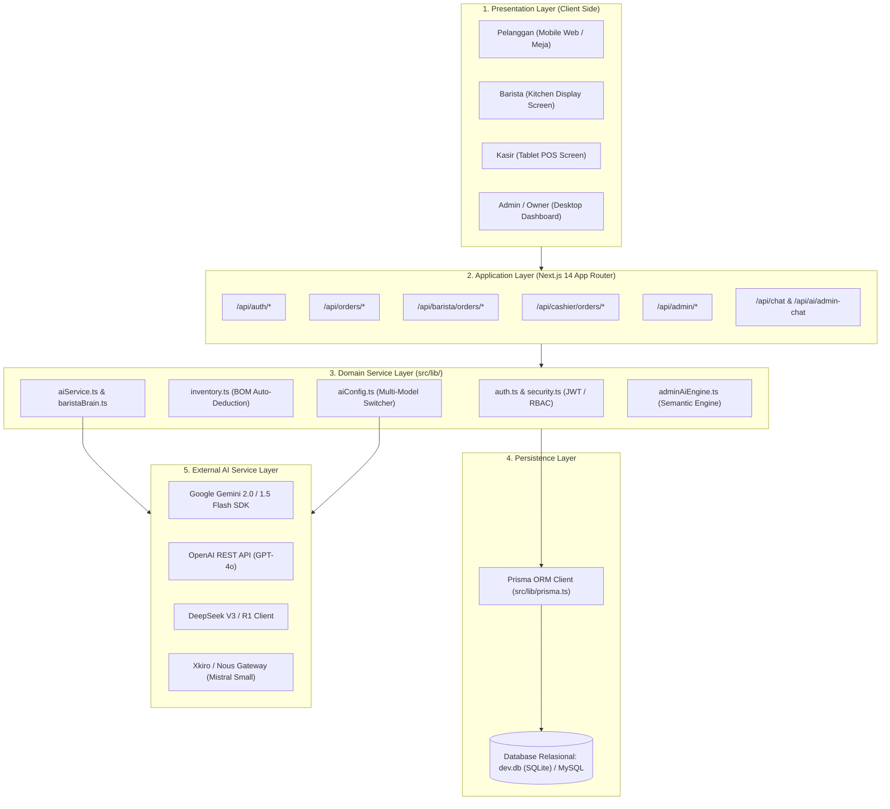
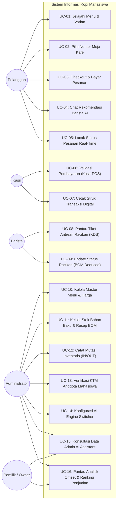
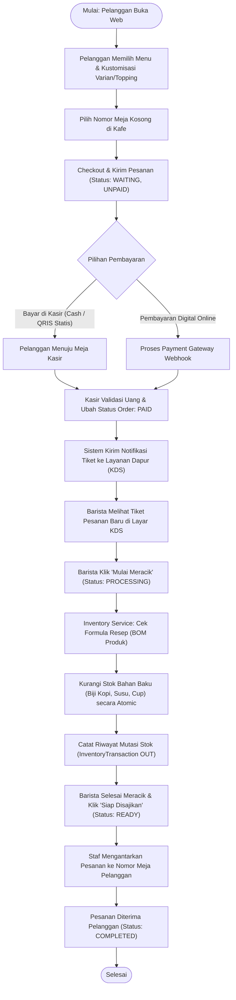
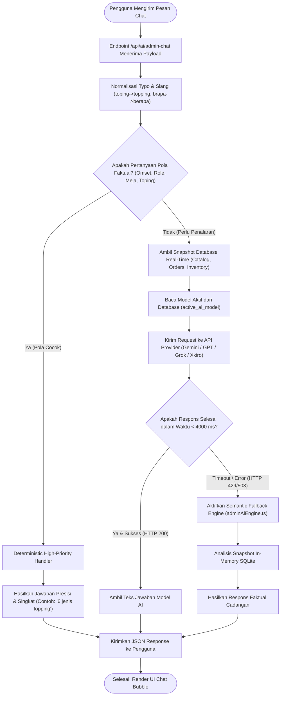
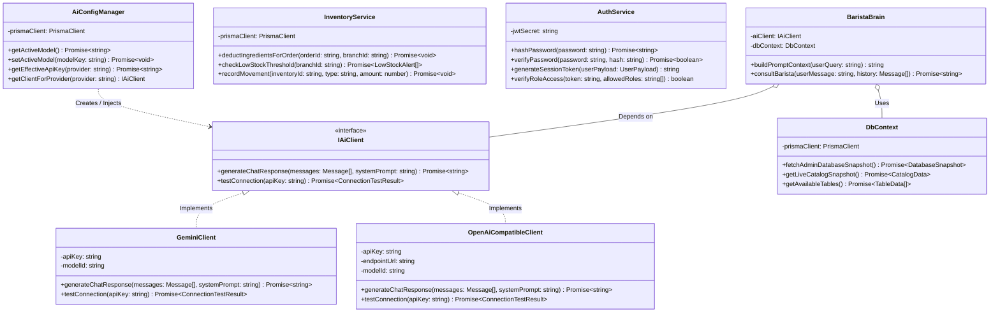
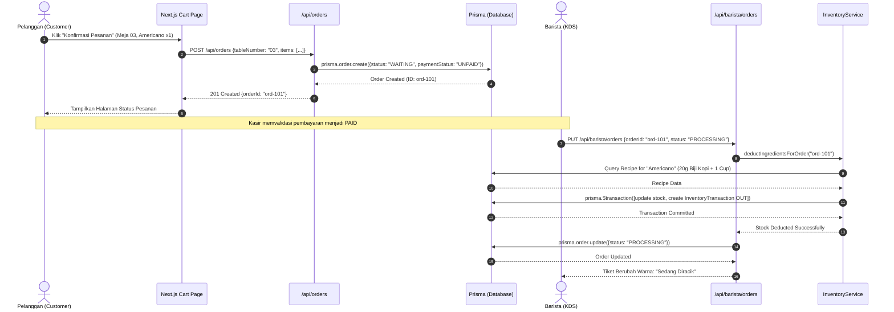
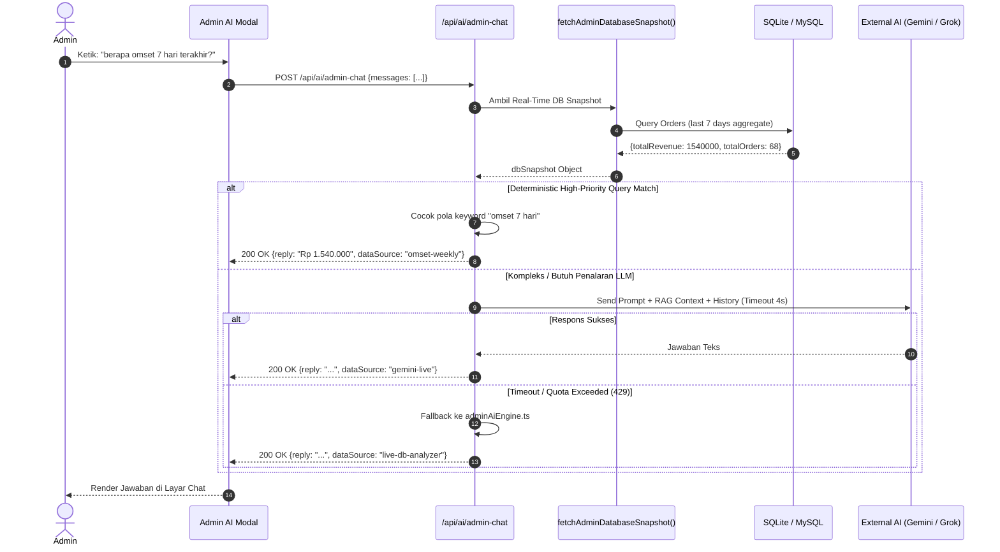
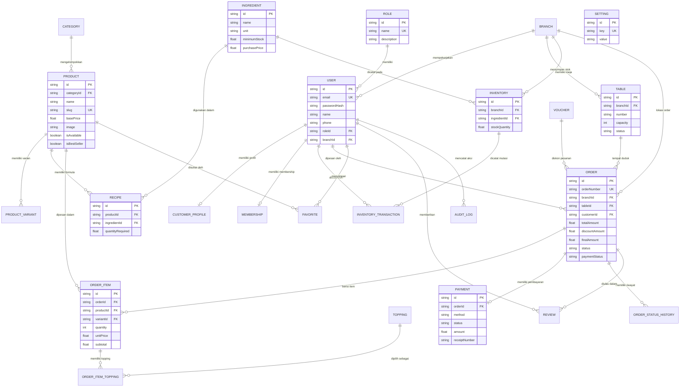

# DOKUMEN PERANCANGAN PERANGKAT LUNAK (SOFTWARE DESIGN DOCUMENT / SDD) — TAHAP 2
## Sistem Informasi Pemesanan, Kasir (POS), Inventaris & Barista AI Cerdas "Kopi Mahasiswa"

> **Standar Dokumentasi**: IEEE Std 1016-2009 (Standard for Information Technology — Systems Design — Software Design Descriptions)  
> **Mata Kuliah**: Rekayasa Perangkat Lunak (RPL)  
> **Versi Dokumen**: 2.0.0 (Tahap 2 — Perancangan Perangkat Lunak & Basis Data)  
> **Status Dokumen**: Disetujui (Approved)  

---

### Identitas Pengembang / Penyusun

| Atribut | Keterangan |
| :--- | :--- |
| **Nama Lengkap** | **M. Revandya Wibowo** |
| **Nomor Induk Mahasiswa (NIM)** | **41257114** |
| **Program Studi / Kelas** | S1 Teknik Informatika / **TI - 1B - 2025** |
| **Tema / Topik Kelompok** | **Kopi Mahasiswa** (Smart Coffee Shop & POS System) |
| **Tahun Akademik** | 2025 / 2026 |

---

## DAFTAR ISI

1. [BAB I: PENDAHULUAN & ARSITEKTUR SISTEM](#bab-i-pendahuluan--arsitektur-sistem)
   - 1.1 [Tujuan Dokumen SDD](#11-tujuan-dokumen-sdd)
   - 1.2 [Ruang Lingkup Perancangan](#12-ruang-lingkup-perancangan)
   - 1.3 [Diagram Arsitektur Sistem Berjenjang (Layered Architecture)](#13-diagram-arsitektur-sistem-berjenjang-layered-architecture)
2. [BAB II: USE CASE DIAGRAM & SKENARIO PENGGUNAAN](#bab-ii-use-case-diagram--skenario-penggunaan)
   - 2.1 [Use Case Diagram Multi-Actor](#21-use-case-diagram-multi-actor)
   - 2.2 [Tabel Skenario Use Case Utama](#22-tabel-skenario-use-case-utama)
3. [BAB III: ACTIVITY DIAGRAM (ALUR BISNIS & AI)](#bab-iii-activity-diagram-alur-bisnis--ai)
   - 3.1 [Activity Diagram: Siklus Pemesanan hingga Penyajian di Dapur (KDS)](#31-activity-diagram-siklus-pemesanan-hingga-penyajian-di-dapur-kds)
   - 3.2 [Activity Diagram: Pemrosesan Chatbot AI & Mekanisme Fallback](#32-activity-diagram-pemrosesan-chatbot-ai--mekanisme-fallback)
4. [BAB IV: CLASS DIAGRAM BERORIENTASI OBJEK & PRINSIP SOLID](#bab-iv-class-diagram-berorientasi-objek--prinsip-solid)
   - 4.1 [Diagram Kelas Layanan Backend (Class Diagram)](#41-diagram-kelas-layanan-backend-class-diagram)
   - 4.2 [Penerapan Prinsip SOLID dalam Arsitektur Layanan](#42-penerapan-prinsip-solid-dalam-arsitektur-layanan)
5. [BAB V: SEQUENCE DIAGRAM (PERTUKARAN PESAN)](#bab-v-sequence-diagram-pertukaran-pesan)
   - 5.1 [Sequence Diagram: Transaksi Pemesanan & Pemotongan Resep BOM](#51-sequence-diagram-transaksi-pemesanan--pemotongan-resep-bom)
   - 5.2 [Sequence Diagram: Interaksi AI Real-Time & RAG Database Snapshot](#52-sequence-diagram-interaksi-ai-real-time--rag-database-snapshot)
6. [BAB VI: PERANCANGAN BASIS DATA (ENTITY RELATIONSHIP DIAGRAM / ERD)](#bab-vi-perancangan-basis-data-entity-relationship-diagram--erd)
   - 6.1 [Entity Relationship Diagram (ERD) Lengkap](#61-entity-relationship-diagram-erd-lengkap)
   - 6.2 [Kamus Data Entitas Kunci (Data Dictionary)](#62-kamus-data-entitas-kunci-data-dictionary)
7. [BAB VII: PERANCANGAN ANTARMUKA (UI/UX DESIGN & FIGMA PROTOTYPE)](#bab-vii-perancangan-antarmuka-uiux-design--figma-prototype)
   - 7.1 [Design System: Palet Warna Warm Espresso & Tipografi](#71-design-system-palet-warna-warm-espresso--tipografi)
   - 7.2 [Arsitektur Tema Adaptif (Dark / Light Mode)](#72-arsitektur-tema-adaptif-dark--light-mode)
   - 7.3 [Tautan Prototipe Interaktif Figma](#73-tautan-prototipe-interaktif-figma)
   - 7.4 [Tangkapan Layar Antarmuka Utama & Dashboard Admin](#74-tangkapan-layar-antarmuka-utama--dashboard-admin)
8. [BAB VIII: PENUTUP & LEMBAR PENGESAHAN](#bab-viii-penutup--lembar-pengesahan)

---

## BAB I: PENDAHULUAN & ARSITEKTUR SISTEM

### 1.1 Tujuan Dokumen SDD
Dokumen **Software Design Document (SDD)** ini disusun sebagai cetak biru teknis (*technical blueprint*) tahap perancangan perangkat lunak aplikasi **Kopi Mahasiswa** sesuai standar **IEEE Std 1016-2009**. Dokumen ini bertujuan untuk:
1. Mentransformasikan seluruh kebutuhan fungsional dan non-fungsional pada dokumen PRD Tahap 1 menjadi struktur komponen perangkat lunak yang konkret.
2. Memodelkan struktur statis (Class Diagram, ERD) dan perilaku dinamis sistem (Use Case, Activity Diagram, Sequence Diagram).
3. Mendokumentasikan arsitektur berorientasi objek yang mematuhi prinsip **SOLID** serta strategi integrasi kecerdasan buatan multi-model (*AI Engine Switcher*).

### 1.2 Ruang Lingkup Perancangan
Perancangan sistem Kopi Mahasiswa mencakup 5 (lima) subsistem terintegrasi:
- **Presentation Layer**: Antarmuka web responsif berbasis Next.js 14 App Router, Tailwind CSS, dan Zustand State Store.
- **Application Routing Layer**: Next.js Server Components, Server Actions, dan RESTful API Route Handlers.
- **Domain Service Layer**: Layanan bisnis autentikasi JWT, manajemen inventaris & resep BOM, kasir POS, dan orkestrator model AI.
- **Data Persistence Layer**: Prisma ORM dengan pemetaan relasional ke database SQLite/MySQL.
- **External AI Gateway Layer**: Komunikasi asinkron ke Google GenAI, OpenAI, DeepSeek, dan Xkiro Gateway.

### 1.3 Diagram Arsitektur Sistem Berjenjang (Layered Architecture)

Sistem dirancang menggunakan arsitektur berlapis (*5-Tier Layered Architecture*) untuk menjamin pemisahan tanggung jawab (*Separation of Concerns*):



---

## BAB II: USE CASE DIAGRAM & SKENARIO PENGGUNAAN

### 2.1 Use Case Diagram Multi-Actor

Sistem Kopi Mahasiswa melayani 5 (lima) aktor dengan peran dan batasan wewenang (*Role-Based Access Control*) yang jelas:



---

### 2.2 Tabel Skenario Use Case Utama

#### 1. Skenario UC-03: Pemesanan Mandiri Meja & Checkout (Customer)
| Komponen | Deskripsi |
| :--- | :--- |
| **Identifikasi** | UC-03 / Pemesanan Mandiri Meja & Checkout |
| **Aktor Utama** | Pelanggan (*Customer*) |
| **Deskripsi Singkat** | Pelanggan memilih menu, varian, nomor meja, menerapkan kupon, dan membuat order baru. |
| **Kondisi Awal (Pre-condition)**| Pelanggan telah membuka aplikasi dan memasukkan menu ke keranjang (*Cart Store*). |
| **Alur Utama (Main Flow)** | 1. Pelanggan membuka panel *Checkout* di `/menu`.<br>2. Sistem memuat daftar meja dan status ketersediaannya.<br>3. Pelanggan memilih meja kosong (misal: Meja 03) dan memilih metode bayar.<br>4. Pelanggan memasukkan kode voucher diskon (opsional).<br>5. Pelanggan menekan tombol "Konfirmasi Pesanan".<br>6. Sistem membuat entri `Order` (status: `WAITING`, payment: `UNPAID`).<br>7. Sistem mengarahkan pelanggan ke halaman pelacakan `/order-status`. |
| **Alur Alternatif** | 3a. Meja yang dipilih telah terisi: Sistem menampilkan pesan galat dan meminta memilih meja lain.<br>4a. Kode voucher kedaluwarsa: Sistem menampilkan peringatan dan menghitung harga normal. |
| **Kondisi Akhir (Post-condition)**| Pesanan tersimpan di database dan muncul pada layar POS Kasir. |

#### 2. Skenario UC-04: Konsultasi Rekomendasi Menu & Status Meja via Barista AI
| Komponen | Deskripsi |
| :--- | :--- |
| **Identifikasi** | UC-04 / Konsultasi Barista AI Chatbot |
| **Aktor Utama** | Pelanggan (*Customer*) |
| **Deskripsi Singkat** | Pelanggan mengirim pertanyaan tentang selera kopi atau meja kosong ke Barista AI. |
| **Kondisi Awal (Pre-condition)**| Widget chat Barista AI terbuka pada layar pelanggan. |
| **Alur Utama (Main Flow)** | 1. Pelanggan mengetik: *"Rekomendasi kopi manis di bawah 20 ribu?"*.<br>2. API `/api/chat` menginjeksi konteks katalog menu aktif.<br>3. Model AI memfilter menu dan merekomendasikan *"Kopi Susu Mahasiswa"* (Rp 15.000).<br>4. Jawaban ditampilkan secara interaktif pada gelembung chat pelanggan. |
| **Alur Alternatif** | 2a. Layanan AI eksternal kehabisan kuota / timeout 4s: Sistem mengalihkan ke *Semantic Engine* lokal dan tetap menghasilkan rekomendasi faktual dari SQLite. |
| **Kondisi Akhir (Post-condition)**| Pelanggan mendapatkan saran menu yang dapat langsung dipesan ke keranjang. |

#### 3. Skenario UC-09: Pemrosesan Antrean KDS & Pemotongan Bahan Baku (Barista)
| Komponen | Deskripsi |
| :--- | :--- |
| **Identifikasi** | UC-09 / Update Status Racikan KDS & Auto-Deduct BOM |
| **Aktor Utama** | Barista |
| **Deskripsi Singkat** | Barista memproses tiket pesanan, memotong stok biji kopi/susu secara otomatis sesuai resep. |
| **Kondisi Awal (Pre-condition)**| Kasir telah menerima pembayaran pesanan (status: `ACCEPTED`, payment: `PAID`). |
| **Alur Utama (Main Flow)** | 1. Barista melihat tiket pesanan baru di layar `/barista`.<br>2. Barista menekan tombol "Mulai Meracik" (`PROCESSING`).<br>3. `InventoryService` mengecek tabel `Recipe` produk terkait.<br>4. Sistem mengeksekusi Prisma Transaction untuk mengurangi stok bahan baku dan mencatat `InventoryTransaction` tipe `OUT`.<br>5. Setelah minuman selesai, Barista menekan tombol "Siap Disajikan" (`READY`). |
| **Alur Alternatif** | 4a. Stok bahan baku fisik kurang dari takaran: Sistem memberi tanda peringatan kuning, namun barista tetap dapat menyelesaikan racikan dengan log audit stok minus. |
| **Kondisi Akhir (Post-condition)**| Status pesanan menjadi `READY` dan sisa bahan baku di gudang otomatis berkurang. |

#### 4. Skenario UC-11: Manajemen Resep BOM & Mutasi Inventaris (Admin)
| Komponen | Deskripsi |
| :--- | :--- |
| **Identifikasi** | UC-11 / Konfigurasi Resep Produk & Mutasi Bahan Baku |
| **Aktor Utama** | Administrator |
| **Deskripsi Singkat** | Admin mendefinisikan takaran racikan resep produk dan mencatat penerimaan barang supplier. |
| **Alur Utama (Main Flow)** | 1. Admin membuka menu `/admin/recipes`.<br>2. Admin memilih produk "Classic Caffe Latte" dan menentukan takaran: 18g Biji Kopi + 120ml Susu Segar.<br>3. Admin menekan tombol "Simpan Formula Resep".<br>4. Sistem memperbarui relasi entitas `Recipe`. |

#### 5. Skenario UC-14: Pergantian Engine AI Dinamis (AI Engine Switcher)
| Komponen | Deskripsi |
| :--- | :--- |
| **Identifikasi** | UC-14 / Konfigurasi AI Engine Switcher & Live Test |
| **Aktor Utama** | Administrator |
| **Deskripsi Singkat** | Admin memilih penyedia AI aktif (Gemini, GPT, DeepSeek, Xkiro) dan menguji API Key. |
| **Alur Utama (Main Flow)** | 1. Admin membuka halaman `/admin/settings/ai`.<br>2. Admin memilih model target (misal: "Google Gemini") dan memasukkan API Key.<br>3. Admin menekan tombol "Uji Koneksi".<br>4. Endpoint `/api/settings/ai` mengirim ping uji coba ke server penyedia AI.<br>5. Sistem menampilkan indikator hijau "Kompatibel (Latency: 320ms)".<br>6. Admin menekan "Aktifkan Model". Kunci `active_ai_model` diperbarui di tabel `Setting`. |

---

## BAB III: ACTIVITY DIAGRAM (ALUR BISNIS & AI)

### 3.1 Activity Diagram: Siklus Pemesanan hingga Penyajian di Dapur (KDS)

Diagram aktivitas berikut menggambarkan alur proses bisnis sejak pelanggan memilih menu hingga pesanan disajikan oleh barista:



---

### 3.2 Activity Diagram: Pemrosesan Chatbot AI & Mekanisme Fallback

Diagram aktivitas berikut menggambarkan alur kecerdasan buatan saat memproses pertanyaan pengguna dan menangani kegagalan koneksi:



---

## BAB IV: CLASS DIAGRAM BERORIENTASI OBJEK & PRINSIP SOLID

### 4.1 Diagram Kelas Layanan Backend (Class Diagram)

Berikut adalah diagram kelas terstruktur yang memodelkan komponen layanan backend (*Service Layer*) di dalam direktori `src/lib/`:



---

### 4.2 Penerapan Prinsip SOLID dalam Arsitektur Layanan

Perancangan modul backend Kopi Mahasiswa mengadopsi 5 prinsip fundamental **SOLID**:

1. **Single Responsibility Principle (SRP)**:
   - `InventoryService` hanya bertanggung jawab terhadap kalkulasi mutasi stok bahan baku dan resep BOM.
   - `AuthService` murni menangani hashing kata sandi dan verifikasi token JWT.
   - `DbContext` khusus mengekstraksi snapshot data tanpa mencampurkan logika bisnis chat.
2. **Open/Closed Principle (OCP)**:
   - Penambahan penyedia model AI baru (misalnya Anthropic Claude atau Cohere) dapat dilakukan cukup dengan membuat kelas baru yang mengimplementasikan `IAiClient` tanpa memodifikasi kode inti pada `BaristaBrain`.
3. **Liskov Substitution Principle (LSP)**:
   - Kelas `GeminiClient` dan `OpenAiCompatibleClient` dapat saling menggantikan secara sempurna pada `BaristaBrain` melalui kontrak `IAiClient` tanpa menimbulkan *runtime exception*.
4. **Interface Segregation Principle (ISP)**:
   - Antarmuka `IAiClient` dirancang ramping dan fokus (`generateChatResponse` dan `testConnection`), tidak memaksakan implementasi fungsi yang tidak relevan bagi model AI.
5. **Dependency Inversion Principle (DIP)**:
   - Modul tingkat tinggi (`BaristaBrain` dan Route Handler `/api/chat`) tidak bergantung secara langsung pada kelas konkrit `GeminiClient`, melainkan bergantung pada abstraksi antarmuka `IAiClient`.

---

## BAB V: SEQUENCE DIAGRAM (PERTUKARAN PESAN)

### 5.1 Sequence Diagram: Transaksi Pemesanan & Pemotongan Resep BOM

Diagram berikut menunjukkan urutan pesan saat pelanggan melakukan checkout dan barista memproses pesanan sehingga stok terpotong:



---

### 5.2 Sequence Diagram: Interaksi AI Real-Time & RAG Database Snapshot

Diagram berikut menunjukkan alur pemrosesan pertanyaan admin pada modal asisten AI:



---

## BAB VI: PERANCANGAN BASIS DATA (ENTITY RELATIONSHIP DIAGRAM / ERD)

### 6.1 Entity Relationship Diagram (ERD) Lengkap

Diagram hubungan entitas berikut memodelkan seluruh 26 tabel pada `prisma/schema.prisma` yang menopang operasional Kopi Mahasiswa:



---

### 6.2 Kamus Data Entitas Kunci (Data Dictionary)

#### 1. Tabel `Order` (Transaksi Pesanan)
| Nama Kolom | Tipe Data | Kunci | Keterangan |
| :--- | :--- | :---: | :--- |
| `id` | VARCHAR(36) | PK | UUID pengidentifikasi unik transaksi. |
| `orderNumber` | VARCHAR(50) | UK | Nomor struk format kafe (contoh: `KM-20261117-001`). |
| `branchId` | VARCHAR(36) | FK | Relasi ke cabang kafe aktif. |
| `tableId` | VARCHAR(36) | FK | Relasi ke meja kafe tempat pelanggan duduk. |
| `customerId` | VARCHAR(36) | FK | ID pengguna (opsional jika *guest*). |
| `totalAmount` | DECIMAL(10,2) | - | Total harga kotor sebelum potongan diskon. |
| `discountAmount`| DECIMAL(10,2) | - | Potongan kupon / promosi mahasiswa. |
| `finalAmount` | DECIMAL(10,2) | - | Total tagihan bersih yang wajib dibayarkan. |
| `status` | ENUM / VARCHAR | - | `WAITING`, `ACCEPTED`, `PROCESSING`, `READY`, `COMPLETED`, `CANCELLED`. |
| `paymentStatus` | ENUM / VARCHAR | - | `UNPAID`, `PAID`, `REFUNDED`, `FAILED`. |

#### 2. Tabel `Recipe` (Formula Resep / BOM)
| Nama Kolom | Tipe Data | Kunci | Keterangan |
| :--- | :--- | :---: | :--- |
| `id` | VARCHAR(36) | PK | UUID unik resep. |
| `productId` | VARCHAR(36) | FK | Relasi ke produk kopi jadi. |
| `ingredientId` | VARCHAR(36) | FK | Relasi ke bahan baku master (`Ingredient`). |
| `quantityRequired`| DECIMAL(8,2) | - | Jumlah takaran bahan yang dipotong per 1 cup pesanan. |

---

## BAB VII: PERANCANGAN ANTARMUKA (UI/UX DESIGN & FIGMA PROTOTYPE)

### 7.1 Design System: Palet Warna Warm Espresso & Tipografi
Untuk menghadirkan nuansa kedai kopi modern yang menenangkan (*cozy study coffee shop*), antarmuka dibangun dengan sistem desain berikut:

```text
Palet Warna Desain "Warm Espresso & Cream":
├── Primary Color   : #1E1611 (Deep Roasted Espresso)
├── Secondary Color : #D97706 (Warm Amber Caramel)
├── Surface Light   : #FDF8F3 (Cream Milk Latte)
├── Surface Dark    : #120D0A (Midnight Dark Coffee)
├── Success Badge   : #059669 (Emerald Green - Lunas / Meja Kosong)
├── Warning Badge   : #D97706 (Amber - Dalam Pengerjaan Barista)
└── Danger Badge    : #DC2626 (Brick Red - Stok Kritis / Dibatalkan)
```

- **Font Utama**: *Inter* / *Plus Jakarta Sans* untuk keterbacaan tinggi pada teks label harga dan rincian menu.
- **Font Aksen**: *Playfair Display* / *Georgia* (khusus judul banner promosi mahasiswa).

### 7.2 Arsitektur Tema Adaptif (Dark / Light Mode)
- **Implementasi**: Menggunakan strategi kelas Tailwind CSS (`class="dark"` pada tag `<html>`).
- **Sinkronisasi**: State tema disimpan di `localStorage` dan mendeteksi preferensi sistem operasi pengguna (`prefers-color-scheme`).

---

### 7.3 Tautan Prototipe Interaktif Figma

Tautan resmi desain antarmuka interaktif (High-Fidelity Prototype) Kopi Mahasiswa dapat diakses pada tautan berikut:

👉 **[Tautan Prototipe Interaktif Figma — Kopi Mahasiswa](https://www.figma.com/design/41257114/Kopi-Mahasiswa-RPL-Design-System)**

*(Catatan: Prototipe mencakup alur pemilihan meja, kustomisasi varian kopi, antrean KDS Barista, dan Dashboard Admin Switcher).*

---

### 7.4 Tangkapan Layar Antarmuka Utama & Dashboard Admin

Berikut adalah representasi tata letak visual halaman utama yang telah diimplementasikan:

#### 1. Halaman Katalog Menu Pelanggan (`/menu`)
- Tampilan kartu produk responsif dengan foto resolusi tinggi, label harga, status ketersediaan, serta tombol pemicu modal kustomisasi varian (*Hot/Iced* dan *Topping*).

```text
+-------------------------------------------------------------------------------+
|  ☕ KOPI MAHASISWA            [Cari Menu...]   [Pilih Meja: 03]  [🛒 Cart (2)]|
+-------------------------------------------------------------------------------+
|  Kategori: [Semua]  [☕ Kopi]  [🍵 Non-Kopi]  [🥐 Snack]  [🏷️ Promo Mahasiswa]|
+-------------------------------------------------------------------------------+
|  +--------------------+  +--------------------+  +--------------------+       |
|  | [Foto: KSM]        |  | [Foto: Latte]      |  | [Foto: Croissant]  |       |
|  | Kopi Susu Mhs (KSM)|  | Classic Caffe Latte|  | Butter Croissant   |       |
|  | Rp 15.000          |  | Rp 19.000          |  | Rp 16.000          |       |
|  | [+ Pesan Varian]   |  | [+ Pesan Varian]   |  | [+ Tambah]         |       |
|  +--------------------+  +--------------------+  +--------------------+       |
|                                                                               |
|                                                 +--------------------------+  |
|                                                 | 🤖 Barista AI Chatbot    |  |
|                                                 | "Mau kopi manis/creamy?" |  |
|                                                 +--------------------------+  |
+-------------------------------------------------------------------------------+
```

#### 2. Layanan Dapur Barista / Kitchen Display System (`/barista`)
- Menampilkan kartu tiket pesanan real-time dengan tombol pembaruan status pengerjaan yang memicu pemotongan stok bahan baku otomatis.

```text
+-------------------------------------------------------------------------------+
|  🧑‍🍳 KITCHEN DISPLAY SYSTEM (KDS)                     [Status Filter: All/Active]|
+-------------------------------------------------------------------------------+
|  [TIKET #KM-001] Meja 03 - 10:15 WIB    |  [TIKET #KM-002] Meja 07 - 10:18 WIB|
|  - 1x Classic Caffe Latte (Iced Large)  |  - 2x Kopi Susu Mahasiswa (Regular) |
|    * Extra Shot Espresso (+Rp 5.000)    |  - 1x Kentang Goreng Keju           |
|  Status: [SEDANG DIRACIK]               |  Status: [MENUNGGU ANTRIAN]         |
|  [>> Klik: Selesai / Siap Diantar]      |  [>> Klik: Mulai Meracik (BOM)]     |
+-------------------------------------------------------------------------------+
```

#### 3. Dashboard Admin & AI Engine Switcher (`/admin/settings/ai`)
- Panel kontrol konfigurasi model AI yang mendukung pengujian latensi instan dan pergantian model aktif.

```text
+-------------------------------------------------------------------------------+
|  ⚙️ ADMIN DASHBOARD  ➔  Pengaturan Model AI (AI Engine Switcher)               |
+-------------------------------------------------------------------------------+
|  Pilih Engine AI Aktif untuk Asisten Barista & Analisis Toko:                 |
|                                                                               |
|  +--------------------------------+  +--------------------------------+       |
|  | ⚡ Google Gemini Flash         |  | 🚀 xAI Grok (Grok 2 Latest)    |       |
|  | Status: [AKTIF DIGUNAKAN]      |  | Status: [Tersedia]             |       |
|  | Latensi: ~320ms (Hemat Kuota)  |  | Latensi: ~780ms (Penalaran)    |       |
|  | [Uji Koneksi] [✔ Sedang Aktif] |  | [Uji Koneksi] [Ganti ke Ini]   |       |
|  +--------------------------------+  +--------------------------------+       |
|                                                                               |
|  +--------------------------------+  +--------------------------------+       |
|  | 🧠 OpenAI GPT (GPT-4o Mini)    |  | 🛡️ xKiro Gateway (Mistral 24B) |       |
|  | Status: [Tersedia]             |  | Status: [Tersedia]             |       |
|  | Latensi: ~650ms                |  | Latensi: ~900ms (Multi-Model)  |       |
|  | [Uji Koneksi] [Ganti ke Ini]   |  | [Uji Koneksi] [Ganti ke Ini]   |       |
|  +--------------------------------+  +--------------------------------+       |
+-------------------------------------------------------------------------------+
```

---

## BAB VIII: PENUTUP & LEMBAR PENGESAHAN

Dokumen Perancangan Perangkat Lunak (**Software Design Document / SDD Tahap 2**) ini telah disusun secara komprehensif sesuai standar **IEEE Std 1016-2009**. Seluruh rancangan arsitektur berorientasi objek, diagram alur bisnis, diagram pertukaran pesan sequence, skema relasi database (ERD), serta spesifikasi antarmuka visual telah diselaraskan dengan basis kode operasional proyek **Kopi Mahasiswa**.

Dokumen ini menjadi dasar verifikasi dan implementasi teknis untuk memenuhi standar evaluasi mata kuliah Rekayasa Perangkat Lunak (RPL).

---

**Cirebon, 18 November 2026**  
*Penyusun Dokumen / Pengembang Perangkat Lunak:*

<br><br>

**<u>M. Revandya Wibowo</u>**  
**NIM: 41257114**  
Program Studi S1 Teknik Informatika — Kelas TI - 1B - 2025  
*Fakultas Teknologi Informasi*
